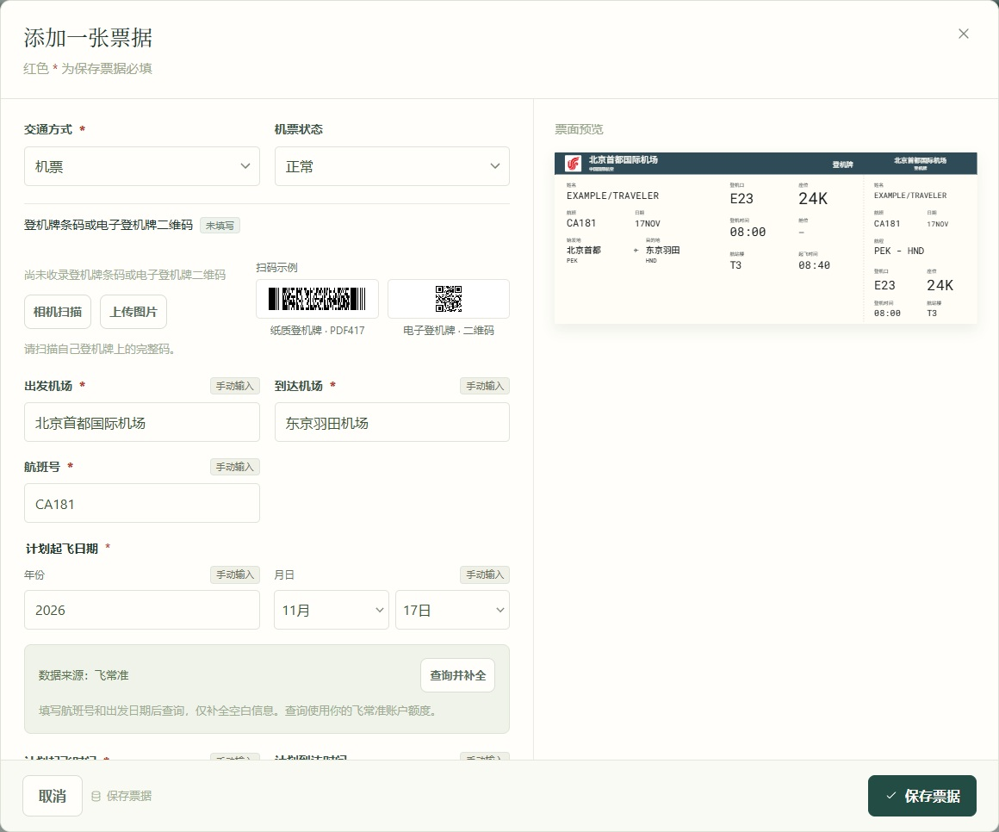
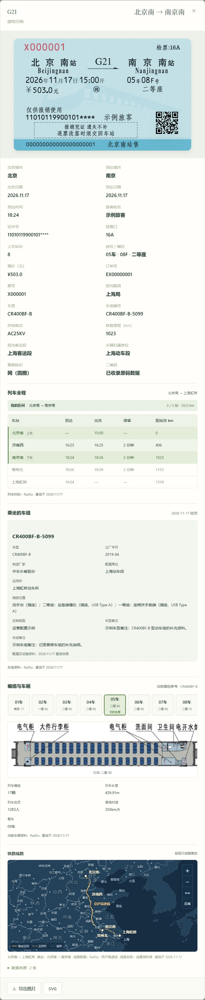
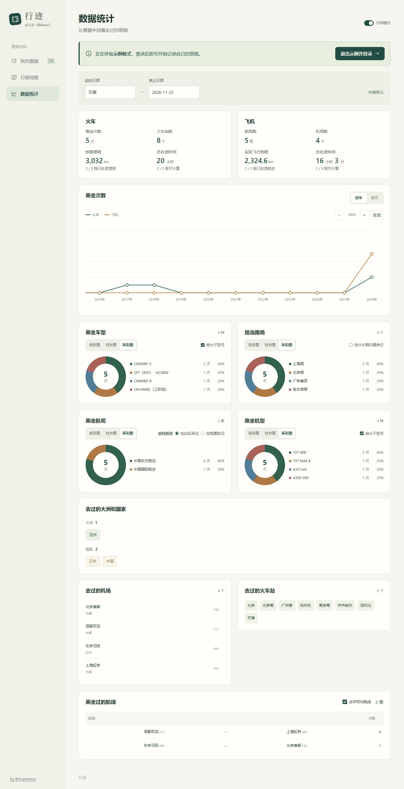

# 行迹 · 票据存档

一个自用的火车票与机票存档工具，电脑和手机都可通过浏览器使用。

**[在线使用](https://yuanzesun.github.io/Xingji/)**

点击“进入示例模式”即可体验票夹、地图与统计。想记录自己的旅程时，退出示例模式并连接云端票库。

## 功能

- 手动填写、相机扫描或上传图片导入票据，也支持文字、邮件和 PDF。
- 还原红票、蓝票、报销凭证与登机牌，导出图片或旅行纪念册。
- 票夹按年份回顾旅程，也能用地图、铁路线和乘坐统计查看足迹。
- 列表与网格均支持小、中两档，可按时间轴回看票据，或拖动旋转 3D 票据球体。
- 查询列车与航班资料补全信息，通过自己的 GitHub 私有仓库或 Cloudflare D1 在多设备间同步。

## 开始使用

按登录页说明连接 GitHub 私有仓库，或按 [D1 部署说明](docs/cloudflare-d1.md) 连接自建的 Cloudflare D1。绑定第二个服务时可选择保留哪边的票库，并覆盖另一边。绑定后由 D1 日常同步，可按需备份到 GitHub。手机可添加到主屏幕使用。

航班补全需在电脑端配置飞常准连接，使用个人账户额度。

Flutter App 正在 [`app` 分支](https://github.com/YuanzeSun/Xingji/tree/app) 开发。

## 导入方式

在「录入」中选火车票，可用相机或上传图片读取纸票上的 144 位二维码。扫码填入的字段会锁定，出发年份仍可校对。二维码包含完整行程时会自动查询一次 RailGo。也可展开「扫描票面」拍照或上传票面进行文字识别。机票可读登机牌条码或电子登机牌二维码。

以下截图和票面均为虚构示例。

「录入票据」页也支持上传铁路票面、12306 购票详情及其他文件，或粘贴行程文字。

## 效果预览

### 票面

保留不同时期的火车票样式，也支持退票费凭证和带航司标识的登机牌。

### 票据详情

打开票据，还能查看站台、完整时刻表、车组与车厢示意图、里程，以及航班行李、常旅客和计划／实际时间等资料。

### 行程地图与铁路线

查看走过的城市与航线，沿铁路回顾列车全程和自己的乘坐区间。

线路图也会标注具体名称，例如京沪高速线。

### 数据统计

按日期查看年、月乘坐次数，以及车型、机型、担当路局、站点与旅行足迹。

### 导出与纪念册

勾选票据，即可导出图片或纪念册。纪念册支持自定义名称与封面。

[查看示例 PDF](docs/examples/journey-album.pdf)

## 免责声明

地图与线路数据来自公开网络资料，仅供行程回顾参考；铁路线按现行资料推定。作者并非专业人士，难免存在疏漏，如发现问题，欢迎[提交 Issue](https://github.com/YuanzeSun/Xingji/issues)。

[数据来源](docs/data-sources.md) · [航司标识](docs/airline-logos.md) · [NCMF 1.0 许可](LICENSE)
