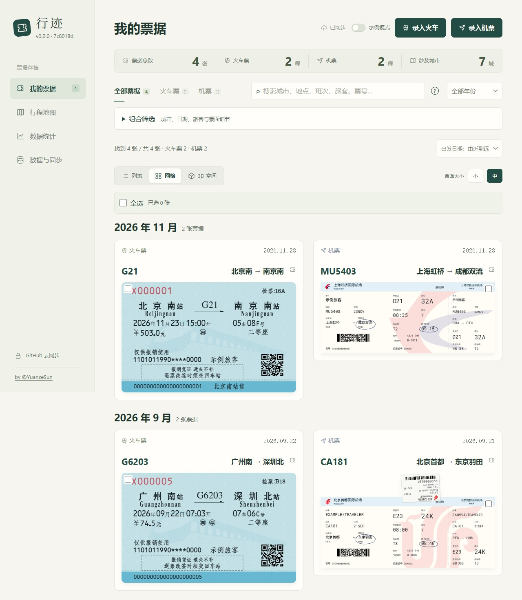
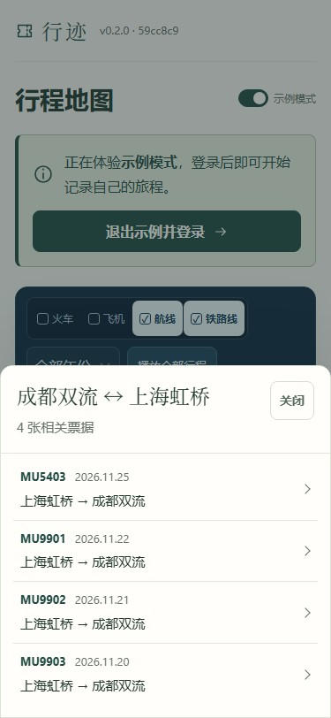
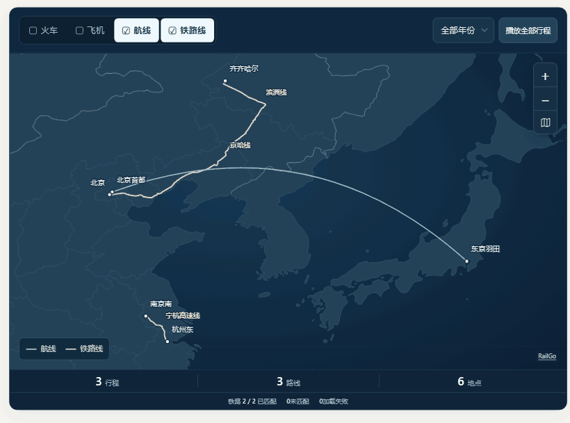
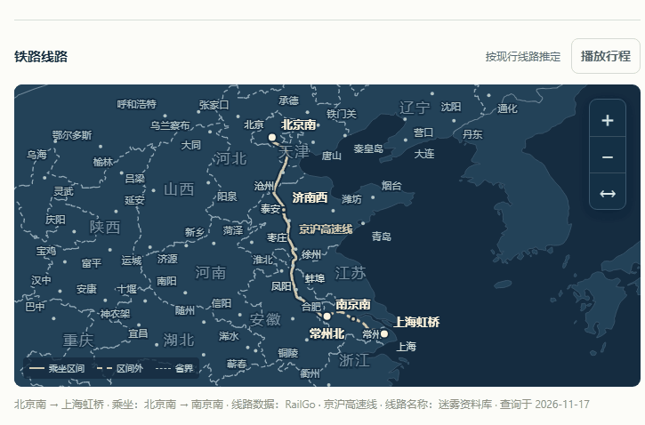
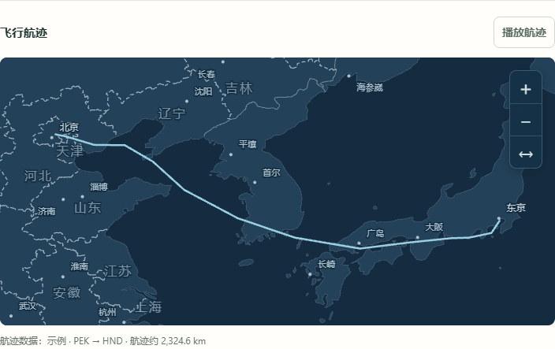
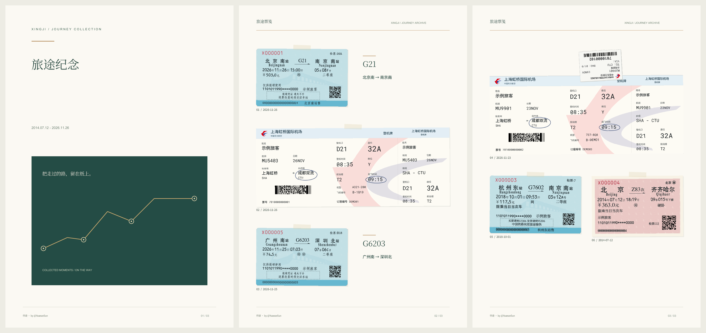

# 行迹 · 票据存档

用手机或电脑收录火车票和登机牌，在票夹、地图和统计中回顾旅行。

[在线使用](https://yuanzesun.github.io/Xingji/) · 可进入示例模式体验

## 功能

- **录入票据** 从票夹右上角分别录入机票和火车票，支持手动填写、扫码、上传火车票票面照片和铁路电子报销凭证 PDF。
- **导入乘车记录** 在电脑上通过 12306 铁路畅行积分明细查询乘车记录，逐张核对后保存。
- **还原票面** 支持各版红色软纸票、蓝色磁介质票、列车移动补票、纸质报销凭证、退票费报销凭证和登机牌。
- **补全行程** 查询列车和航班资料，记录经停、车组、机型、行李等信息。
- **回顾旅行** 按月份整理票夹，从地图上的地点和线路打开相关票据，逐段播放全部或单年行程。分别统计火车和飞机的在途时间、里程和乘坐次数，也可查看航司、车型、机型和多次乘坐的同一列车或飞机。
- **导出与同步** 导出票据图片和旅行纪念册，支持 JSON 备份恢复及 GitHub 私有仓库、Cloudflare D1 同步。可在个人资料中保存常用证件。

## 效果预览

以下为虚构行程示例。

### 票据录入

### 票面

### 票据详情

### 行程地图与路线播放

### 数据统计

### 旅行纪念册

[查看示例 PDF](docs/examples/journey-album.pdf)
