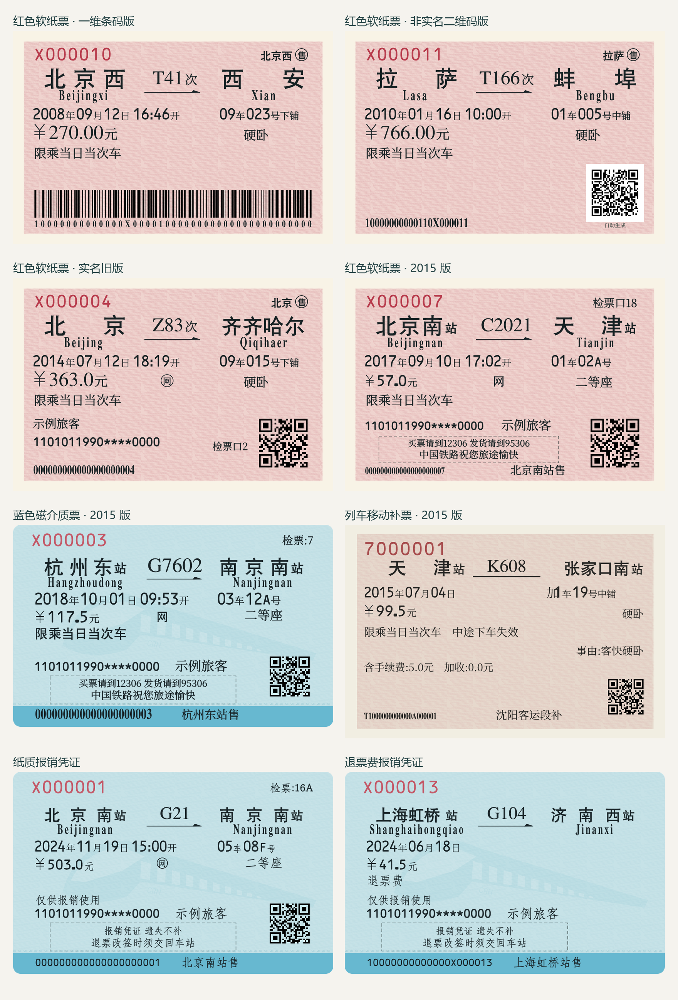
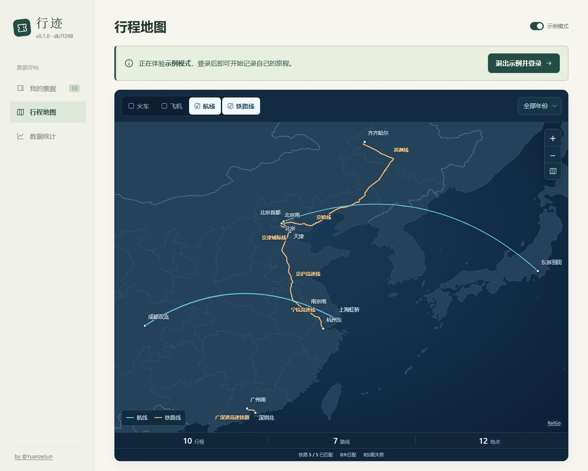

# 行迹 · 票据存档

用手机或电脑收录火车票和登机牌，在票夹、地图和统计中回顾旅行。

[在线使用](https://yuanzesun.github.io/Xingji/) · 可进入示例模式体验

## 功能

- **录入票据** 支持手动填写、相机扫码、上传票面照片，以及从行程文字、邮件和 PDF 导入。
- **还原票面** 支持红色软纸票、蓝色磁介质票、报销凭证、退票费凭证和登机牌。
- **补全行程** 查询列车和航班资料，记录经停、车组、机型、行李等信息。
- **回顾旅行** 按年份整理票夹，用地图查看路线和足迹，用统计了解乘坐次数、车型和机型。
- **导出与同步** 导出票据图片和旅行纪念册，支持 JSON 备份恢复及 GitHub 私有仓库、Cloudflare D1 同步。

## 预览

以下为虚构行程示例。

