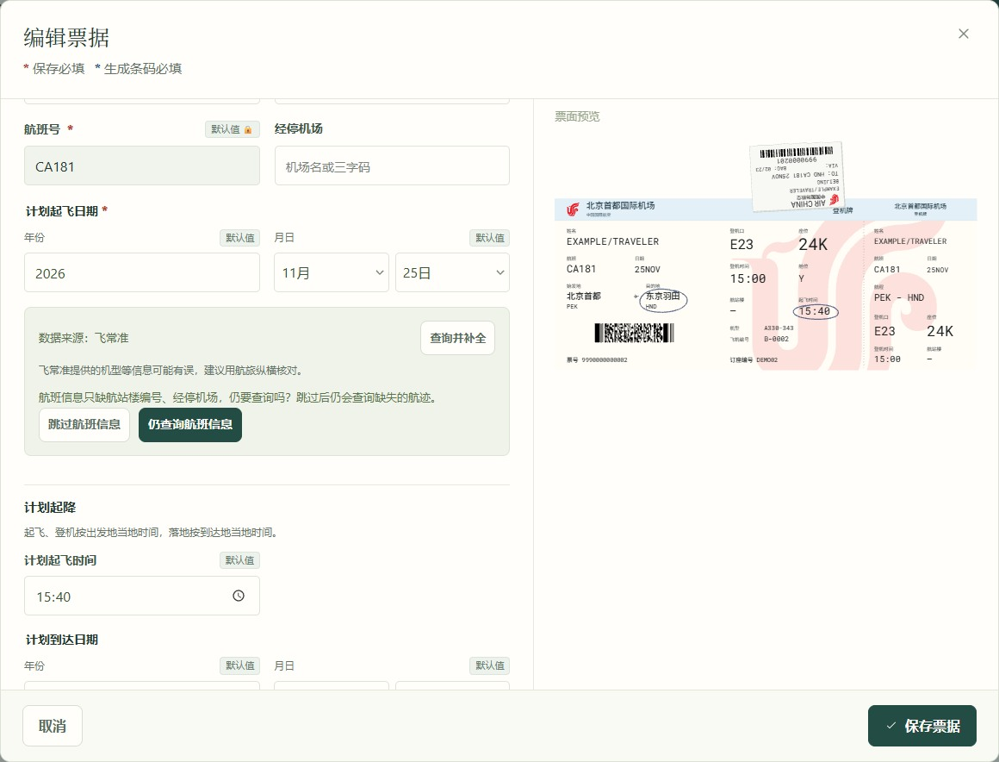
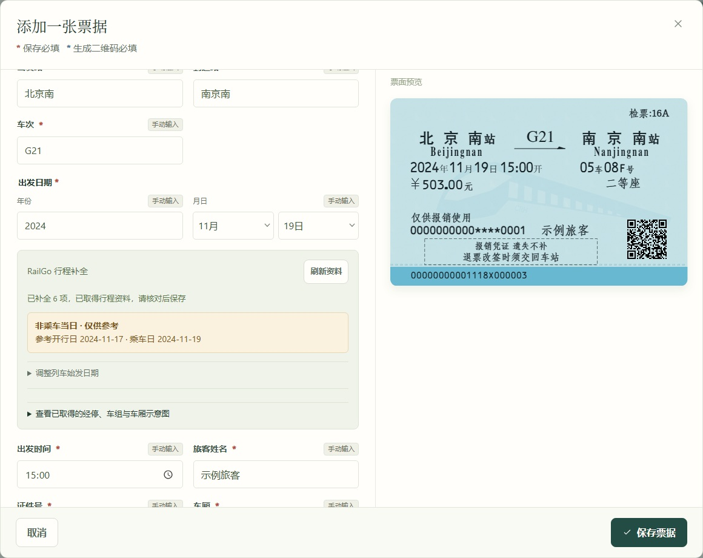

# 航班补全与可扩展的数据来源

调研核验日期：2026-11-16 至 2026-11-17。以下区分已经接入的功能、可选数据源与后续功能建议；建议项没有自动加入应用。

## 已接入：飞常准航班补全

录入或编辑机票时，填写完整航班号和出发日期，点击「查询并补全」。应用按需查询航班资料、飞机编号和航迹，跳过已有值和锁定字段。航班资料只缺航站楼或经停机场时，可跳过航班信息，继续查询缺失的航迹。结果随票保存，详情可播放已收录的航迹。编辑器按航段与查询类型缓存结果五分钟。

单个匹配航段自动补全空白字段，多个航段先选择。已有内容、已手动校正字段、旅客、证件、座位、舱位、票价、PNR、票号和条码不被覆盖。返回后若航班、日期、机场或连接已改变，或编辑器已关闭，结果不填入。数据仍需核对并手动保存。

航班状态可提供机场、计划与实际起降时刻、航程距离、航司、机型、飞机编号、两端航站楼和登机口。登机时间为空时，可以用飞常准明确提供的计划登机时刻补全。带时区偏移的时间转换为所在机场的当地时间。飞机编号优先读取航班状态的 `aircraftNumber`，缺失时用 `getAircraftRotation` 核对实际执飞机。机型依据多个字段的一致性识别，存在冲突时提示核对。

代码共享航班有明确执飞航班号时，按票面航班号和执飞航班号分别识别营销航司和承运航司。出发航站楼可读取 `FlightDepTerminal` 或 `FlightHTerminal`，到达航站楼可读取 `FlightArrTerminal` 或 `FlightTerminal`。这些资料来自同一次航班状态查询。符合现有导入格式的历史行程也可保留已有的航站楼、登机口、营销航司和登机时刻。

机型识别已覆盖 DHC-6/7/8、ATR、ERJ/E-Jet、CRJ、C909/C919 等，支持常见名称和明确的设备代码；扫描、导入、补全、登机牌与统计使用相同的名称处理。[覆盖范围和参考来源](aircraft.md)。

已核对实际服务端工具定义，并用公开样例 `CA181 / 2023-11-18` 验证历史查询。该次返回有机场、计划时刻、航站楼、登机口和具体型号；这只证明该样例可查询，不承诺所有历史日期都齐全。测试样例不涉及本人行程或个人身份信息。

- [现有平台的 getFlightStatus 文档](https://cmcp.variflight.com/tools/#getFlightStatus)：`fnum + date`，可加具体机场 `dep / arr`。
- [飞常准航班状态字段](https://dataworks.variflight.com/about-us/download-zone/flight-status-query-api-docs/)
- [飞机编号查询 getAircraftRotation](https://cmcp.variflight.com/en/tools/#getAircraftRotation)
- [另一套飞友 AI Aviation MCP 文档](https://ai.variflight.com/zh/docs/aviation)：`searchFlightsByNumber`，公开标价 50 积分／次，1 积分为 0.01 元。它采用不同端点、工具名和认证方式，不能将该价格或 Key 直接套用到现有平台。应用没有擅自迁移。

现有平台的具体业务扣费和完整历史覆盖未在公开文档中充分说明，以使用者账号权益为准。API 是否收费取决于数据授权与供应商计费，MCP 本身只是调用协议。

## 不用 MCP 的公开数据

| 来源 | 能提供什么 | 额度、覆盖与接入判断 |
| --- | --- | --- |
| [adsbdb](https://www.adsbdb.com/) | 按航班呼号查航司、当前起降机场与部分经停；按注册号或 Mode-S 查飞机资料 | GET 无需 Key，无积分计费；有滚动分钟限速。实测 `CCA181` 可返回航线，允许浏览器跨域。没有日期参数，不能核实历史当天；其航线数据另有复制、入库和发布许可限制，暂未接入存档。 |
| [adsb.lol 实时 API](https://www.adsb.lol/docs/open-data/api) | 呼号、位置、注册号、机型等实时 ADS-B 信息 | 无需 MCP，但当前无 Key 为 500 次／日／IP；免费 Key 也分额度。因此不承诺为不限量服务，且无法替代历史计划时刻。 |
| [adsb.lol 每日历史归档](https://www.adsb.lol/docs/open-data/historical) | 可免费下载逐日、逐飞机的轨迹文件，采用 ODbL 许可 | 没有逐航班付费查询，但需下载、解析、索引原始数据；覆盖取决于接收站。原始轨迹不包含完整商业航班计划、航站楼和登机口，不适合直接让纯静态网页按航班号查全年档案。 |
| [美国 BTS 逐航班历史数据](https://transtats.bts.gov/DL_SelectFields.aspx?QO_fu146_anzr=b0-gvzr+cr4s14zn0pr&gnoyr_VQ=FGJ) | 日期、承运航司、航班号、起降机场、计划／实际时刻、机尾号等可下载字段 | 免费下载，无 MCP 与查询积分；覆盖规定范围内的美国国内航班，按月发布。适合后续做离线索引或文件导入，不覆盖中国国内航班。 |
| [OpenSky](https://dev.opensky-network.org/about/faq) | 轨迹、飞机身份及由轨迹推断的起降机场 | REST API 有积分／频率限制；研究历史数据需符合其开放条件。官方明确不提供完整商业时刻、取消与延误信息，不宜作为本项目默认补全源。其现行条款另要求运行产品接入事先取得书面许可。 |
| [OurAirports](https://ourairports.com/data/) | 机场、国家、坐标等基础资料 | Public Domain 下载，可离线使用且无运行时额度；项目已使用。它是基础参考库，不提供某天某航班的实际飞机或时刻。 |

本轮尚未核实到同时覆盖中国多年历史、支持航班号和日期、具备完整时刻与具体执飞机型、可长期免费不限额度入库的通用服务。公开数据可以作为分工明确的补充，不会将当前航线或实时飞机资料冒充为历史当天记录。

其他收费 REST 备选：[aviationstack](https://aviationstack.com/pricing) 免费档为每月 100 次实时查询，历史数据在付费档且为近三个月；[AeroDataBox](https://aerodatabox.com/pricing/) 有不同套餐的历史窗口，具体完整性应参考其[覆盖表](https://aerodatabox.com/data-coverage/)；[FlightAware AeroAPI](https://www.flightaware.com/commercial/aeroapi/faq.rvt) 历史数据可到 2011 年，但需有历史权限的付费档。当前均未接入。

## RailGo 还能提供什么

项目已接入 `mapLine` 获取铁路线点，`getTrainMain` 补全所乘区间时刻、车型、担当路局、担当客运段和车辆归属单位，并提供经停回看、具体车组文字资料与单节车厢示意图；不加载编组原图或车厢、设施照片。线路坐标及整理后的时刻表随票据保存、备份并同步，已有匹配线路时直接读取。路局、车型、段级单位均可手动填写，列车资料不印在车票上。 自动补全值随票据记录来源，重新刷新可更新未被手动修改的自动值；手动填写和原票识别信息保留。车次、日期或区间改变后，失效的自动值与行程快照清除。

编辑器默认以乘车日查询 RailGo，确认查询日开行且上车日期相符时才自动填入。当天查不到时，可按「RailGo 原始返回」中的开行日期调整 RailGo 查询日期。采用其他日期的 RailGo 资料时会显示参考日期。原始返回仅供当次编辑查看。RailLog 和 Open CRH Tracker 始终按乘车日查找资料。三家可补充同一张票，字段保留各自的来源和资料日期，跨来源差异由用户逐项选择。查询填入的字段可以手动编辑，票码及导入凭证各自的字段锁定继续生效。

查询仅发送公开车次、日期、上车站电报码或查到的车组号，不发送姓名、证件、座位、票价。担当路局采用 `bureau` 及官方对照表，担当客运段取 `runner`，车辆归属单位取 `carOwner`，不混用或由站点推断。普速示例 Z22 可返回“西宁客运段”和“西宁车辆段”；普速记录不要求动车所或动车组编号。编辑器及详情展示来源链接，车组资料同时保留定制类型、车型备注与具体车组备注。资料快照随 JSON 和云同步保存；修改日期、车次或乘车区间后，不再沿用失配快照。

[RailGo 使用说明](https://api.railgo.dev/)目前免 Key，未列出按次收费方案，但有自动频率限制；要求公开展示来源及链接，限制规定范围内的商业使用和公开接口中转。因此不能理解为永久免费无限量。[车次主数据文档](https://api.railgo.dev/479755220e0)提供可选 `date`，省略为当天；[线路点文档](https://api.railgo.dev/479769351e0)仅有 `train`，现有路线图因而仍按现行线路推定。[车厢图](https://api.railgo.dev/479766603e0)也仅有车次参数，不能用来核实过去某天的编组。

2026-11-17 实测 `G1 / 2026-11-17` 返回成功，担当局 H（上海局）、车型 CR400BF-S；`G1 / 2023-11-18` 返回 400、无数据。支持传日期不等于覆盖全部历史，官方没有承诺统一的多年历史查询窗口。

以下其他功能仍是可选方向，尚未接入：

| 数据能力 | 可以做的功能 | 注意点 |
| --- | --- | --- |
| [车次主数据 getTrainMain](https://api.railgo.dev/479755220e0)：时刻表、跨日数、停车时间、车型、担当路局／段、运行日 | 铁路录入补全、起终站选择、经停站时间轴 | 日期是首站发车日。实测当前 G1 有数据，2010 年样例返回无数据，不能用当前时刻或车型填历史票。 |
| [正晚点 getTrainDelayAll](https://api.railgo.dev/406912287e0) 与[车站大屏](https://api.railgo.dev/479337926e0) | 出行当天的状态卡、车站到发屏 | 区分实际与预测状态，缺失不是正点；不默认轮询。 |
| [动车组运行记录](https://api.railgo.dev/507411980e0)：日期、车组号、是否重联 | 匹配乘坐过的具体车组、车组收藏 | 只有记录确实命中该日期和车次才可关联，不推断完整历史。 |
| [动车组配属详情](https://api.railgo.dev/507418598e0)：子型号、生产时间、所属段、制造商和插座信息 | 车型／车组资料卡 | 需先拿到具体车组号，资料为其维护快照。 |
| [列车车厢图 getCoachPic](https://api.railgo.dev/479766603e0)：编组图、车厢图、设施位置 | 展示本次列车编组及座位、餐车等位置参考 | 主要针对动车组，来源是动态图片 URL；不承诺所有列车或历史日期可用。 |
| [车站查询](https://api.railgo.dev/366547236e0)：所在省市、所属路局和车务段、车站类型、停靠车次及到发时间 | 车站资料卡，从站点查看关联票据和当前停靠列车 | 站点资料和过站车次是查询快照，不能用作旧票日期的证据。 |
| [站到站车次查询](https://api.railgo.dev/366464961e0) | 录入时先选起终站，再从候选车次中选择 | 用于辅助查找当前候选车次，需核对日期；不作为历史乘坐记录来源。 |
| [调图查询](https://api.railgo.dev/528488319e0)：调图期车站的车次及起终点、到发时刻 | 查看某站调整后的车次，或制作调图前后对比 | 官方标为测试中；它返回车次列表，对比和变更分类需要本地计算。 |

还可以进一步组成三种功能，而不必增加其他统计指标：

1. **时刻和乘坐区间补全**：车次和日期查时刻表，用户选上车站和下车站后，填入对应出发／到达时刻、到达日期。列车全程的首末站不能直接代替用户乘坐区间，跨日车次也要换算首站发车日。
2. **行程详情资料卡**：经停站时间轴展示到达、发车、停留分钟和跨日；若有当天车组记录，再展示具体车组号、重联情况、车型和制造信息。车厢图可补充餐车、无障碍车厢、护理台和插座位置参考。
3. **车站资料卡／出行当天卡片**：前者展示省市、所属路局及已存关联行程；后者按需查询检票口、站台、出站口和正晚点。当前大屏、设施和车型资料不自动追溯填入历史票。

已实现区间时刻补全、经停站回看、具体车组资料卡和当前编组车厢图。车组运行记录必须同时匹配始发日和车次；多条冲突记录不作选择，重联保留两个编号，配属详情还需核对返回编号；补全空白车型时优先采用该日具体车组已核对的型号。历史记录缺失时不会借用当前车厢接口的车组号；配属与设施注明查询快照，车厢图明确标为当前参考。可点击车厢切换图片，突出车票上的车厢；其他已存行程含同一已匹配车组时，提供重逢链接。车站资料卡、大屏及正晚点功能尚未实现。电报码继续仅供内部使用。

2026-11-17 另做了四次公开样例请求，均返回成功并允许跨域：`G1 / 2026-11-17` 主数据含 7 个停站；G1 动车组运行查询返回 40 条记录，最新一条为 2026-11-16 的 `CR400BF-A-5085`；`CR400BF-5033` 配属详情含 2018-04 生产月份及上述设施字段；G1 车厢图返回 16 辆编组、16 张车厢图及餐车／护理台／无障碍车厢位置。运行记录的最新日期落后于查询当天，且不同接口的车型快照可能不同，故无法只凭当前车次号确认历史当天车组。

已扩展行程补全和详情展示，并支持铁路参考里程。车站大屏尚未接入；正晚点不纳入当前功能。

[RailGo 使用限制](https://api.railgo.dev/)：当前免 Key，要求署名并链接来源，禁止规定范围内的商业用途和公开接口中转服务，并有防爬频率限制。现有地图沿用浏览器直接请求和显著来源链接。

线路坐标以原始 JSON 随票据保存，不压缩；录入或编辑时点击 RailGo 查询取得全程及乘坐区间，主动再次查询会刷新线路快照。详情与铁路线视图只读取已保存的匹配线路，不在查看时查询或补存。列车时刻、车组文字资料和单节车厢示意图链接同样随票据保存；示意图文件按链接联网加载，不存入 GitHub，也不额外离线缓存。编组原图、车厢与设施照片不加载，婴儿护理台、办公席、无障碍及卫生间、商务座等资料字段不保存或显示。

完整列车行程保存全程经停，并高亮票据起终站之间的乘坐区间。铁路参考里程来自 V1 累计公里数之差；仅在车次、运行日及全部停站名称、时刻和跨日信息均与本次 V2 查询一致且累计里程有效时补全。未匹配时留空，用户可手动填写；变更行程会清除未手动校正的自动里程。

车型和供电制式独立保存。DC600V 为直流 600V，AC380V 为交流 380V；同型号存在不同供电制式，不进行车型推断。参考：[中车 25T 技术参数](https://www.crrcgc.cc/cccl/2017-11/08/article_B963ADCB0B044ED1A5F22D660C30924B.html)、[中车 25G 技术参数](https://www.crrcgc.cc/cccl/2017-11/08/article_F4560A3ED74948ED92359E3F4A094DF3.html)。

2026-11-17 另核对了牵引机车来源：[RailGo 公开接口目录](https://api.railgo.dev/llms.txt)、[车次主数据](https://api.railgo.dev/479755220e0)及 [V1 车次查询](https://api.railgo.dev/366464494e0)提供客车／动车组车型、车辆归属及客运担当；未提供按日期、运行区间记录普速列车牵引机车型号、车号或换挂站的字段。25T／25K 是客车车型，不能据此推断 HXD3D 等牵引机车型号。[Open CRH Tracker](https://crh.lihugang.top/docs/api)的历史担当以动车组为主，[RailLog](https://raillog.top/api-docs/)公开时刻表及用户行程也不等于完整的逐区间机车运用记录。本次未找到可直接接入、覆盖历史日期与换挂区间的可靠公开机车担当接口，因此未新增自动补全或统计。若后续获得可信来源，应按区间保存机车型号、车号和来源，避免给整趟列车固定一个机车。

BSP 车型补充核验：V1 实测 Z15、Z51 返回“25T (BSP)”，Z5 返回“25T (国产)”；V2 的 Z83 返回原始车型 `BSTAC380V`。[RailGo 自己的车型字典](https://github.com/RailGoApps/RailGo-Parser/blob/main/railgo/config.py#L239)将 `BST`、`BSTAC380V`、`25TAC380V` 映射到“25T (BSP)”，将 `25TDC600V` 映射到“25T (国产)”。导入 RailGo 数据时按此字典解释型号，同时将原字符串中明确给出的 AC380V／DC600V 保存到供电字段；不把该供应商字典套到用户任意手填的车型文字。本次 Z83 响应的运行日从 2026-11-25 开始，不含用户指定的 2026-11-17，因此未将这一响应作为该日期实际担当的确认。路路通应用能展示车型信息，但本次未找到可直接采用的公开接口文档；无需据此否定 RailGo 本身已有的 BSP 标记。

[检票口 getExit](https://api.railgo.dev/406961130e0)支持车次、内部车站电报码及可选日期，返回检票口列表、站台和出站口。实测 G21／济南西／2026-11-17 返回“6A-7A检票口”“6B-7B检票口”、7 站台及 A3／B3 到达口。2023-05-26 的响应内容相同；连续日期或跨日期的检票口相同本身不构成查询无效的证据，也不能仅据此确认历史数据留存范围。录入或编辑时随 RailGo 查询补全上车检票口和站台，按上车站日期及该站车次查询；结果随票据保存，手动填写的内容保留。

车站输入候选复用内置的 [12306 车站名库](https://kyfw.12306.cn/otn/resources/js/framework/station_name.js)，支持汉字、全拼和首字母；候选列表显示站名和城市，不显示内部电报码，也不请求在线预选词服务。

铁路线路名称采用[迷雾资料库的命名轨迹](https://fog.vicc.wang/rails)。RailGo 的 `mapLine` 返回站点、轨迹坐标和顺序，本身不提供“京哈线”等线名。录入或编辑时点击铁路资料补全，会先按站名缩小命名轨迹候选范围，再将 RailGo 的 GCJ-02 坐标转换到 WGS84 做连续轨迹对照；短暂共线、仅同站或相互难以区分的平行轨道不直接用于认定线路名。结果与乘坐区间、列车全程的线路快照分别保存，详情和行程地图读取已保存的名称，不另行联网查询。外部名称源失败时仍保存原有 RailGo 线路。命名轨迹在会话内复用，首次查询最多下载 12 条去重后的候选轨迹，并限制同时请求数。

铁路线路补全时同步查询乘坐区间的地表海拔，采样最多 100 点。海拔值随线路快照保存，轨迹相同时复用已有海拔值。票据详情直接显示已保存的海拔剖面，支持离线查看和与线路动画联动。[Open-Meteo 高程接口](https://open-meteo.com/en/docs/elevation-api)
